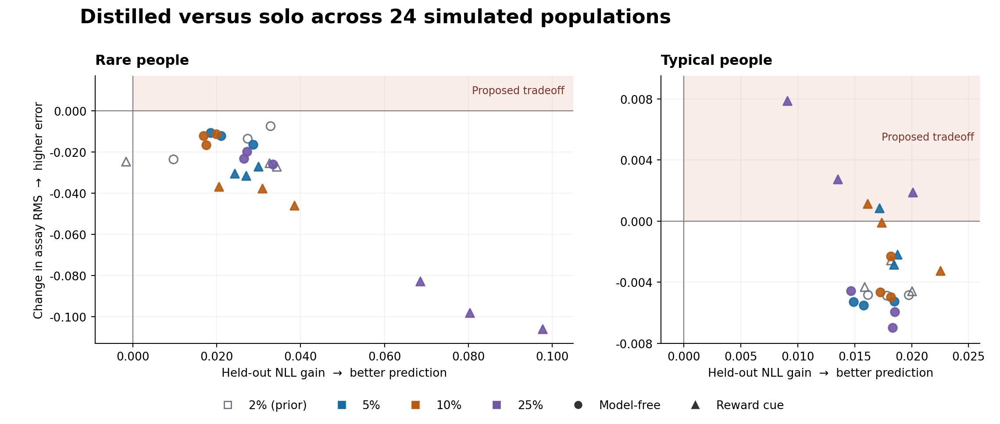

# Distilled Tiny RNNs

**Can a small model predict choices better while becoming less faithful to the strategy behind them?** This benchmark tests that question in a simulated two-stage decision task. The simulator provides each player's true choice probabilities and behavioral signature for comparison.

[Replay the results](docs/result-replay.md) · [Per-population results](review/notebook08-audit/primary-tables.md) · [Full report](review/notebook08-audit/report.md) · [Study protocol](docs/main-study-protocol.md)

This repository is the clean release copy of the 100-trial benchmark.

## What we found

Across **24 simulated populations**, the distilled pipeline improved held-out prediction in **23 of 24** rare-group averages and reduced behavioral assay error in **all 24**, relative to the solo pipeline. The tradeoff was absent from rare-group averages and appeared for **156 of 2,520 individual rare players**.

The averages conceal differences across groups and measures. At 5% reward-cue prevalence, probability estimates worsened on diagnostic trials in all three populations. At 25% reward-cue prevalence, typical players had better prediction and worse assay error in all three populations.



Each point is one population's group mean. Positive prediction gain means lower negative log likelihood. Positive assay change means higher error. The rare and typical panels use different axis scales.

## How it works

- **Simulate** 1,000 players per population, each completing 100 trials. The two rare strategies are model-free learning and a reward-cue rule. Each strategy is tested at 2%, 5%, 10%, and 25% prevalence, with three independently generated populations per setting.
- **Train** one pooled 32-unit GRU teacher and separate two-unit GRU students for each player. The solo students fit observed choices with L2 regularization of 0.1. The distilled students fit teacher probabilities with zero L2. The oracle students fit exact simulator probabilities with zero L2.
- **Evaluate** first-stage choices held out from the training loss within the same players' interspersed histories. Observed choices, including held-out ones, can become inputs on later trials. The behavioral assay measures how often a model repeats a choice after combinations of reward and transition. A separate diagnostic scores probability error where the rare policy differs from a fixed reference.

These results compare the complete fitting recipes at a fixed history length. The hybrid/cue mixture had lower prediction and assay error than distillation in every rare group. Its candidate grids include the generating policies. The benchmark uses a first-stage adaptation of the published tinyRNN method. [Controls and scope](review/notebook08-audit/report.md#3-controls-and-scope) · [Method comparison](docs/published-method-alignment.md) · [Original paper](https://doi.org/10.1038/s41586-025-09142-4)

## Verify and run

**Inspect the saved results.** This standard-library check compares the two archived calculations across all 24 populations.

```sh
python3 review/notebook08-audit/metrics/cross_check_primary.py
```

**Replay from the original arrays.** Follow the download and checksum instructions, then run the primary analysis on CPU with NumPy. [Result replay](docs/result-replay.md)

**Run the original pilot.** On macOS, Linux, or WSL with Python 3.10+, run the following from the repository root. The small CPU pilot produces `outputs/smoke/report.json` and `outputs/smoke/quadrant.png`.

```sh
python3 -m venv .venv
.venv/bin/python -m pip install -e '.[test]'
.venv/bin/python -m distilled_rnns.cli --config configs/smoke.json --output outputs/smoke --device cpu
```

The [model tests](tests/test_models_training.py) compare batched per-player GRU outputs, gradients, and optimizer updates with independent PyTorch models. The [runner tests](tests/test_main_runner.py) cover interrupted and completed runs. Run the suite with `.venv/bin/python -m pytest -q`. In a full Git clone, execute all five current Notebook 08 cells with small CPU fixtures using `.venv/bin/python scripts/verify_rarity_notebook.py --pinned-archive`.

## Run in Colab

Open a notebook from the table, select a T4 GPU runtime, and run the code cells in order. The notebooks download and verify pinned revisions from GitHub's public archive endpoint without a GitHub token. Colab asks for normal Google Drive permission to save results and resumable checkpoints under `MyDrive/distilled-tiny-rnns/runs/`.

| Notebook | Purpose | Details |
| --- | --- | --- |
| [01 · Pilot](https://colab.research.google.com/github/WeaversMask/distilled-tiny-rnns-benchmark/blob/main/notebooks/01_colab_pilot.ipynb) | Short feasibility run | [Methodology](docs/methodology.md) |
| [02 · Follow-up](https://colab.research.google.com/github/WeaversMask/distilled-tiny-rnns-benchmark/blob/main/notebooks/02_colab_followup.ipynb) | Solo regularization and fresh seeds | [Protocol](docs/followup.md) |
| [03 · Baseline audit](https://colab.research.google.com/github/WeaversMask/distilled-tiny-rnns-benchmark/blob/main/notebooks/03_colab_baseline_audit.ipynb) | Baselines and checkpoint selection | [Protocol](docs/baseline-audit.md) |
| [04 · Robustness](https://colab.research.google.com/github/WeaversMask/distilled-tiny-rnns-benchmark/blob/main/notebooks/04_colab_robustness.ipynb) | Longer fits and new seeds | [Protocol](docs/robustness.md) |
| [05 · Oracle control](https://colab.research.google.com/github/WeaversMask/distilled-tiny-rnns-benchmark/blob/main/notebooks/05_colab_oracle_control.ipynb) | Teacher targets vs. known probabilities | [Protocol](docs/oracle-control.md) |
| [06 · Budget check](https://colab.research.google.com/github/WeaversMask/distilled-tiny-rnns-benchmark/blob/main/notebooks/06_colab_budget_check.ipynb) | Continue the soft-target fits from a completed Notebook 05 run | [Prerequisites and resume](docs/budget-check.md#running) |
| [07 · 2% rarity](https://colab.research.google.com/github/WeaversMask/distilled-tiny-rnns-benchmark/blob/main/notebooks/07_colab_main_study.ipynb) | Six main-study populations at 2% rarity | [Run and resume](docs/main-study-running.md) |
| [08 · Rarity sweep](https://colab.research.google.com/github/WeaversMask/distilled-tiny-rnns-benchmark/blob/main/notebooks/08_colab_rarity.ipynb) | Eighteen additional populations at 5%, 10%, and 25% rarity | [Baseline and resume](docs/rarity-tranche.md#running-notebook-08) |

For a quick Colab check of the rarity workflow, run the first three code cells of Notebook 08. They create their own small baseline and check that all smoke runs can resume. For the full run, download the audited 2% baseline and follow the setup instructions. [Notebook 08 production setup](docs/rarity-tranche.md#running-notebook-08)

## Credit and citation

WeaversMask maintains the simulator, batched fitting code, behavioral assay, and benchmark in this repository. The verification records include automated tests, numerical checks, and internal AI-assisted reviews. [Citation metadata](CITATION.cff) · [Verification records](review/)

## License

The original software is available under the [MIT License](LICENSE). The synthetic data and benchmark results are available under [CC BY 4.0](DATA-LICENSE.md).
