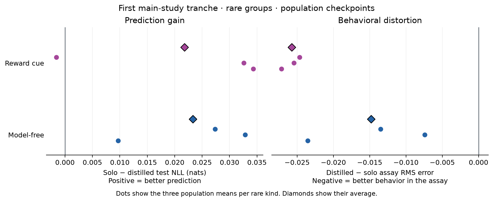

# First main-study tranche results

Verified 2026-11-05 from the complete `main-study-first-tranche-v1` and
`main-study-smoke-b5c5aa888e9b` downloads. Production includes all six planned
populations and smoke all four. Every required result is saved, including the
reports generated before the notebook's final display cell. All 146 input
files remained byte-for-byte unchanged during verification.

## Plain-English finding

The students taught by the pooled teacher generally predicted held-out choices
better than students trained directly on each person's choices. Their average
error in the predeclared behavioral assay also decreased in all six populations.
The proposed group-level combination of better prediction and worse assay
behavior therefore did not appear in this first tranche of the main study.

Other measurements give a mixed picture. On diagnostic trials, where the rare
policy disagrees with the fixed reference, the distilled students' probability
estimates became slightly less faithful than solo on average for both rare
kinds. The cue strategy remained poorly captured in absolute terms. A baseline
that could fit either learning rule predicted those people much better and
reproduced their assay behavior more closely.

The result supports improvement over this particular solo recipe alongside
continuing errors on important histories. The primary assay and secondary
conditional diagnostics measure different aspects of behavior and retain their
predeclared roles.

## Design and score definitions

Each population contains 1,000 people, including 20 rare people, and 100 trials.
Three populations use model-free rare people among hybrids, and three use
reward-cue rare people. The teacher has H=32, and independent students H=2.
All 18 student arms reached 4,000 steps. All settings and seeds were fixed
before these populations were examined. [Frozen protocol](main-study-protocol.md).

NLL measures the probability assigned to observed choices. True-policy KL
measures discrepancy from the known generating probabilities. Lower scores
are better. Diagnostic scores use only held-out trials with an absolute
true/reference probability difference greater than 0.2.

The behavioral assay starts from the initial state and integrates three
first-stage choices under 70/30 transitions, fair second-stage actions and
fair rewards. It compares four reward/transition stay probabilities with the
true policy. RMS is the error across those four cells. This short controlled
assay and the longer drifting-task histories supply complementary evidence.

Scores weight people equally within each group, then populations equally.
There are three populations per rare kind. Diagnostic means use supported
people and retain nulls when support is absent.

## Predeclared primary comparison

Prediction gain is solo minus distilled test NLL. Behavioral distortion is
distilled minus solo assay RMS. Positive values for both would describe the
proposed tradeoff. Population checkpoint selection is primary.

| Rare kind | Prediction gain | Assay error change | Better prediction | Lower assay error |
| --- | ---: | ---: | ---: | ---: |
| Model-free | +0.023313 | -0.014819 | 3/3 | 3/3 |
| Reward cue | +0.021778 | -0.025741 | 2/3 | 3/3 |

Dots are population means and diamonds are their equal-population average.
The figure displays descriptive variation across the three populations.

| Rare kind / seed | Prediction gain | Assay error change | People with better prediction and worse assay |
| --- | ---: | ---: | ---: |
| Model-free / 202611401 | +0.009710 | -0.023548 | 0/20 |
| Model-free / 202611411 | +0.032842 | -0.007395 | 5/20 |
| Model-free / 202611421 | +0.027387 | -0.013512 | 2/20 |
| Reward cue / 202621401 | +0.034327 | -0.027147 | 1/20 |
| Reward cue / 202621411 | +0.032596 | -0.025420 | 0/20 |
| Reward cue / 202621421 | -0.001589 | -0.024655 | 1/20 |

Across populations, seven of 60 model-free rare people and two of 60 cue rare
people had better prediction together with worse assay behavior. These
individual exceptions coexist with the group improvements. Typical people
also occupied that quadrant, at 557/2,940 and 634/2,940 respectively. The counts
are descriptive and do not establish a rare-specific effect.

The secondary per-person checkpoint rule retains the mean directions. Its
model-free prediction gain is +0.024194 and assay change is −0.014428. The cue
gain is +0.031145 and change is −0.020861. Prediction and assay improve in all
six populations under that rule. The corresponding individual tradeoff counts
are six and three rare people.

The primary distilled/solo comparison changes both fitting objective and L2
regularization, from the fixed solo L2=0.1 to the distilled L2=0. It measures
these predeclared pipelines. Separating individual causes requires additional
controls with their own prospective specification.

## Diagnostic disagreement

| Rare kind | Solo diagnostic KL | Distilled diagnostic KL | Distilled error higher |
| --- | ---: | ---: | ---: |
| Model-free | 0.134172 | 0.144456 | 3/3 |
| Reward cue | 0.202218 | 0.207003 | 2/3 |

Diagnostic observed-choice NLL also rises on average. Model-free scores change
from 0.630126 solo to 0.651752 distilled, with higher error in all three
populations. Cue scores change from 0.707602 to 0.710884, with higher error in
two of three. Overall NLL, overall true-policy KL and the declared assay improve
on average, while these conditional diagnostic scores worsen.

Model-free diagnostic support consists of 184 test trials from 35 of 60 rare
people. Cue support consists of 612 trials from 52 of 60. The all-person assay
and supported diagnostic comparison differ in both history distribution and
which people contribute. The assay resets state and spans three choices,
whereas diagnostic scores use the observed 100-trial histories.

Uniform probe-history KL improves for distilled versus solo in all six
populations. Directional pull has another pattern. For model-free people,
mean pull rises from 0.948400 solo to 1.065054 distilled, although RMS falls.
For cue people it falls from 1.043429 to 0.926868. Pull is a projection toward
the true typical-group signature and can legitimately fall outside zero to one.
These measurements should remain visible individually.

## Model comparisons in the rare groups

Every number is the mean of three population scores. Neural rows use
population-selected weights. All metrics below are lower when better.

### Model-free

| Model | Test NLL | True-policy KL | Diagnostic KL | Assay RMS | Probe KL |
| --- | ---: | ---: | ---: | ---: | ---: |
| Pooled teacher | 0.640186 | 0.049455 | 0.138356 | 0.082757 | 0.031371 |
| Solo | 0.666510 | 0.071349 | 0.134172 | 0.099317 | 0.054795 |
| Teacher-target student | 0.643197 | 0.051838 | 0.144456 | 0.084499 | 0.037652 |
| Oracle-target student | 0.614645 | 0.028056 | 0.041957 | 0.054420 | 0.049841 |
| Individual hybrid-grid ML | 0.599478 | 0.011188 | 0.009970 | 0.022643 | 0.004918 |
| Pooled hybrid-grid ML | 0.642003 | 0.049172 | 0.116112 | 0.065723 | 0.023833 |
| Hierarchical hybrid | 0.606601 | 0.013593 | 0.043408 | 0.040672 | 0.007400 |
| Hybrid/cue mixture | 0.600320 | 0.008621 | 0.020211 | 0.028910 | 0.004381 |
| Coinflip | 0.693147 | 0.096918 | 0.195752 | 0.099678 | 0.044385 |
| Training frequency | 0.685346 | 0.088083 | 0.163727 | 0.103727 | 0.065803 |

### Reward cue

| Model | Test NLL | True-policy KL | Diagnostic KL | Assay RMS | Probe KL |
| --- | ---: | ---: | ---: | ---: | ---: |
| Pooled teacher | 0.673235 | 0.143192 | 0.203229 | 0.210090 | 0.141160 |
| Solo | 0.696419 | 0.172651 | 0.202218 | 0.245217 | 0.177149 |
| Teacher-target student | 0.674641 | 0.147346 | 0.207003 | 0.219476 | 0.154170 |
| Oracle-target student | 0.589732 | 0.074145 | 0.086029 | 0.087675 | 0.097284 |
| Individual hybrid-grid ML | 0.665596 | 0.137723 | 0.190833 | 0.214836 | 0.139875 |
| Pooled hybrid-grid ML | 0.682700 | 0.154584 | 0.212349 | 0.239418 | 0.166768 |
| Hierarchical hybrid | 0.662722 | 0.134241 | 0.191637 | 0.216184 | 0.141577 |
| Hybrid/cue mixture | 0.544619 | 0.018319 | 0.028235 | 0.066211 | 0.017599 |
| Coinflip | 0.693147 | 0.169984 | 0.196644 | 0.245000 | 0.171424 |
| Training frequency | 0.700925 | 0.177454 | 0.208153 | 0.245776 | 0.183197 |

The mixture beats the teacher-target student in test NLL, overall KL, assay
RMS and uniform probe KL in all three populations for each rare kind. For cue
people, its NLL is 0.544619 compared with 0.674641, and its assay RMS is 0.066211
compared with 0.219476. The benchmark deliberately includes the generating
policies in the classical candidate grids, so these comparisons evaluate
performance with the correct family available.

The mixture's posterior classifies 33/60 cue rare people as cue and 6/2,940
cue-population typical people as cue using a posterior greater than 0.5. Good
average prediction can coexist with unresolved individual mechanism labels.
No classification threshold enters the primary comparison.

The teacher's own rare-group errors are close to the ordinary student's.
Oracle-target students, with the same H=2 architecture but exact simulator
probabilities at fitting positions, improve observed-history true-policy KL,
diagnostic KL and assay RMS over ordinary students in all six populations.
Oracle NLL improves in all cue populations and two of three model-free
populations. These results implicate target quality under the fixed recipe.

The oracle does not dominate every readout. Its model-free uniform probe KL is
higher in all three populations, averaging 0.049841 versus 0.037652 for ordinary
students. Its model-free RMS is lower, 0.054420 versus 0.084499. The four-cell
signature and uniformly weighted probe histories retain different information.

## Typical groups, selection and timing

Distilled students improve average typical-group prediction and assay RMS in
all six populations. This benefit extends beyond the rare people. Mean NLL
gains are +0.017921 in model-free populations and +0.018034 in cue populations.
Assay changes are −0.004853 and −0.003827 respectively.

The six teachers used the declared validation patience, stopping after
250–330 updates and selecting steps 50–130. Every student completed 4,000
updates. No population-selected student state was at the limit. Individual
states selected at the limit numbered 8/6,000 solo, 129/6,000 ordinary distilled
and 145/6,000 oracle. Among rare people alone, the counts were one, one and
seven out of 120. Earlier selections and flat observed-choice curves leave
convergence unresolved. Soft-target arms optimize a different objective from
the observed-choice learning curves. The audit retains current and selected
soft-target losses for inspection.

Saved checkpoints record 7,028.7662 seconds of training, or **117.15 minutes**.
The runner records **118.86 minutes** over four invocations, with complete wall
time coverage. All contributing sessions recorded Tesla T4. At the supplied
1.07 units per T4-hour rate, training alone corresponds to **2.0891 units**.
Setup, preflight, idle runtime and other Colab billing lie outside this proxy.
A longer-history cell needs measured runtime for its own compute scheduling.

## Verification and next step

The integrity audit matched the frozen production and smoke configurations,
source/protocol hashes, every listed artifact hash, inventories, regenerated
data/masks, finite checkpoint and Adam state, optimization counters, cumulative
selection and elapsed-time accounting. Safe checkpoint loading used
`weights_only=True`. Independent calculations from the saved arrays matched
all subject/group metrics, primary contrasts, support/nulls, seed directions
and summaries. Classical controls were refitted using training observations
only and reproduced their saved probabilities and fixed-posterior assay
policies.

Production CPU reconstruction differed from the original saved T4 outputs by
at most 0.000004113 for observed-history probabilities and 0.000001282 for
probe probabilities. Both fit the original 0.000005 absolute tolerance.
Population-mean validation differed by at most 0.000000060 and per-person
validation by 0.000000537, within their original respective tolerances. No
tolerance or numerical source was changed to accept these results.

The smoke run completed all four tiny planned populations and its software
checks passed. Its scores exercise the implementation. Production supplies
the scientific results above. All 146 downloaded files retained their original
hashes. Original absolute Colab paths remain provenance and were not rewritten.

Record this completed tranche as mixed evidence and retain the frozen primary
outcome. The next research stage varies rarity and history according to the
existing prospective design, scheduling its next tranche before evaluating it.
Keep the original recipe and all declared controls. The current timing applies
to this 100-trial cell and does not set a cost forecast for the remaining grid.
Three populations per kind support descriptive means, ranges and directions.

[Integrity audit](../review/main-study-integrity-verification.json) ·
[Independent raw-metric audit](../review/main-study-raw-metric-verification.json) ·
[Independent interpretation review](../review/main-study-results-independent-review.md).
