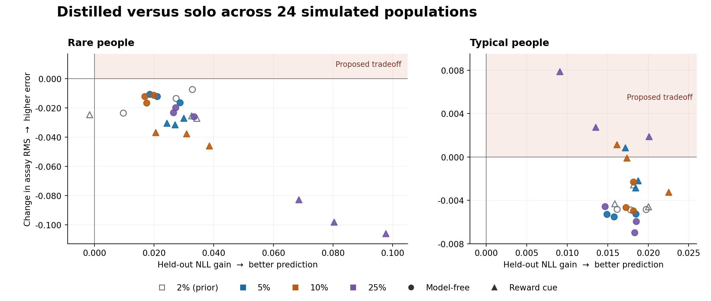

# Notebook 08 rarity tranche audit

Reviewed 10 November 2026.

[Replay the primary comparison from the saved arrays on CPU](../../docs/result-replay.md).

**The predeclared tradeoff did not appear in the average rare group at any of the four rarities.** In all 18 new populations, distilled students predicted held-out choices better and had lower error in the behavioral assay than solo students. This held for both simulated rare strategies at 5%, 10%, and 25%. The verified prior 2% baseline had lower assay error in all six populations and better prediction in five. Across the 24 populations, the alternative per-person checkpoint rule improved both scores in every rare group.

The secondary results are mixed. On diagnostic trials, reward-cue probability estimates became less faithful in all three 5% populations, even though their assay error fell. And among **typical people** in the 25% reward-cue populations, prediction improved while assay error rose in all three seeds. Both findings qualify how broadly the primary improvement applies.

## 1. Predeclared primary outcome

Each population contains 1,000 simulated people with 100 trials each. There are three independent populations per rarity and strategy. NLL gain is solo minus distilled held-out negative log likelihood, so positive values mean better prediction. RMS change is distilled minus solo error across the four assay cells, so negative values mean closer behavior to the generating strategy. The means weight people equally within each group, then weight populations equally. All primary rows use population-wide checkpoint selection. The 2% populations are prior evidence.

| Rarity | Rare strategy | NLL gain, mean [range] | RMS change, mean [range] | Both improve | Tradeoff | Only assay improves | Both worsen | Ties |
| --- | --- | --- | --- | --- | --- | --- | --- | --- |
| 2% (prior) | Model-free | +0.023313 [+0.009710, +0.032842] | -0.014819 [-0.023548, -0.007395] | 3 | 0 | 0 | 0 | 0 |
| 2% (prior) | Reward cue | +0.021778 [-0.001589, +0.034327] | -0.025741 [-0.027147, -0.024655] | 2 | 0 | 1 | 0 | 0 |
| 5% | Model-free | +0.022777 [+0.018547, +0.028693] | -0.012934 [-0.016297, -0.010495] | 3 | 0 | 0 | 0 | 0 |
| 5% | Reward cue | +0.027056 [+0.024269, +0.029940] | -0.029628 [-0.031494, -0.026980] | 3 | 0 | 0 | 0 | 0 |
| 10% | Model-free | +0.018076 [+0.016808, +0.019931] | -0.013297 [-0.016552, -0.011193] | 3 | 0 | 0 | 0 | 0 |
| 10% | Reward cue | +0.029951 [+0.020531, +0.038446] | -0.040123 [-0.045994, -0.036815] | 3 | 0 | 0 | 0 | 0 |
| 25% | Model-free | +0.029034 [+0.026485, +0.033376] | -0.022941 [-0.025942, -0.019737] | 3 | 0 | 0 | 0 | 0 |
| 25% | Reward cue | +0.082162 [+0.068521, +0.097684] | -0.095651 [-0.106036, -0.082802] | 3 | 0 | 0 | 0 | 0 |

[All 24 seeds with both checkpoint rules](primary-tables.md) · [Person-level quadrant counts and fractions, including ties](person-quadrants.md)

**Model-free.** Mean prediction gains ranged from +0.018076 to +0.029034 in the three new cells. The 25% populations had the largest mean improvements on both primary coordinates, while the 10% prediction gain was smaller than the 5% gain. The pattern across rarities is descriptive and uses different simulated people at each level.

**Reward cue.** The 25% cell had the largest improvement on both primary coordinates. Its average gain was +0.082162 and its RMS change was −0.095651. Solo test NLL stayed near 0.69 at every rarity. Teacher NLL fell from 0.663451 at 5% and 0.650662 at 10% to 0.578309 at 25%. Distilled NLL fell from 0.668989 and 0.662024 to 0.612230. The larger 25% gain coincided with better absolute teacher and distilled performance.

**Typical people.** Population-selected distilled students improved test NLL in all 24 typical groups. All 12 model-free typical groups and seven of 12 reward-cue typical groups also had lower assay error. The five exceptions were one seed at 5%, one at 10%, and all three at 25% reward cue. In that 25% cell, mean gain was +0.014217 and RMS change was +0.004168, with changes ranging from +0.001879 to +0.007888. Per-person checkpoint selection retained this direction in all three seeds, with mean gain +0.012029 and RMS change +0.002240.

**Individual people.** Across all 24 populations, 156 of 2,520 rare people had better prediction and worse assay error under population selection. In the three new model-free cells, 20/150, 45/300, and 74/750 rare people had better prediction together with worse assay error under population selection. The corresponding reward-cue counts were 2/150, 0/300, and 6/750. There were zero exact ties under this rule. The per-person checkpoint rule had exact ties on both coordinates for some people, so the supporting tables keep those ties separate from the four strict quadrants.

## 2. Diagnostic scores and behavioral interpretation

Diagnostic test trials are those where the true choice probability differs by more than 0.2 from the fixed 0.75-hybrid reference on the same observed history. Diagnostic means use supported people within each population and then supported populations within each cell. The table shows changes from solo to distilled, so positive changes are worse for both diagnostic NLL and KL. The count in parentheses gives the number of populations with higher error out of three.

| Rarity | Rare strategy | Supported trials | Supported people | Diagnostic NLL change | Diagnostic KL, solo → distilled | Diagnostic KL change |
| --- | --- | ---: | ---: | ---: | --- | ---: |
| 2% (prior) | Model-free | 184 | 35/60 | +0.021626 (3/3) | 0.134172 → 0.144456 | +0.010283 (3/3) |
| 2% (prior) | Reward cue | 612 | 52/60 | +0.003282 (2/3) | 0.202218 → 0.207003 | +0.004785 (2/3) |
| 5% | Model-free | 340 | 73/150 | −0.045285 (0/3) | 0.153469 → 0.121200 | −0.032269 (0/3) |
| 5% | Reward cue | 1,490 | 128/150 | −0.000323 (2/3) | 0.201512 → 0.204196 | +0.002685 (3/3) |
| 10% | Model-free | 725 | 149/300 | −0.031393 (0/3) | 0.143107 → 0.114888 | −0.028218 (0/3) |
| 10% | Reward cue | 3,011 | 250/300 | +0.002947 (1/3) | 0.205824 → 0.200107 | −0.005717 (1/3) |
| 25% | Model-free | 1,939 | 418/750 | −0.044422 (0/3) | 0.138498 → 0.090250 | −0.048247 (0/3) |
| 25% | Reward cue | 7,435 | 638/750 | −0.082973 (0/3) | 0.196282 → 0.117918 | −0.078364 (0/3) |

Both diagnostic measures improved in all nine new model-free populations, reversing the 2% pattern. At 10% reward cue, diagnostic KL improved in two seeds and worsened in one. Mean diagnostic NLL rose because the one increase exceeded the two decreases combined. At 25% reward cue, both diagnostic scores improved in all three rare groups and worsened in all three typical groups. Typical-group mean diagnostic NLL rose by +0.039331 and KL by +0.029446 there.

The assay integrates three choices from the initial state over all 256 two-trial histories. It uses the evaluated policy to weight earlier first-stage choices, with 70/30 transitions, fair second-stage actions, and fair rewards. The four stay probabilities are ordered unrewarded rare, unrewarded common, rewarded rare, rewarded common. Diagnostic scores use supported positions in the observed 100-trial histories. The different histories and support allow the two measures to move in opposite directions.

Uniform third-choice probe KL fell in every rare group under distillation. For model-free rare people, pull toward the typical signature increased in all six new 5% and 10% populations and changed in both directions at 25%. For rare reward-cue people, pull decreased in every population at every rarity. Pull is a signed projection and can fall outside [0, 1]. The full tables retain the four stay probabilities, RMS, KL, pull and support counts, including null scores where support is absent. [All model scores and diagnostic support](model-and-diagnostic-tables.md)

## 3. Controls and scope

The oracle-target H=2 student improved test NLL, all-test true-policy KL, diagnostic KL, and assay RMS over ordinary distillation in all 18 new rare groups. Its model-free probe KL was higher in all nine new populations. Access to simulator probabilities improved several outcomes under this recipe, with differences across how behavior was measured.

The hybrid/cue mixture had lower test NLL, diagnostic KL, assay RMS and probe KL than ordinary distillation in every rare group. At 25% reward cue its mean NLL was 0.541452 and RMS was 0.040054, versus 0.612230 and 0.147470 for distilled, and 0.592466 and 0.071350 for oracle. The mixture starts with equal prior mass on both families and fits only observable training choices. Its candidate grids include the simulated generators by design. The fitted posterior is fixed throughout the assay. At a cue posterior above 0.5, it classified 33/60, 93/150, 214/300, and 594/750 rare cue people across the four rarities as cue. Typical cue calls in those same populations were 6/2,940, 13/2,850, 40/2,700, and 86/2,250. The supporting tables give fitted priors, posterior ranges, counts near the threshold and mean posterior entropy by seed. [Control and recovery tables](model-and-diagnostic-tables.md)

The primary comparison changes both targets and regularization. Solo uses observed choices with L2 0.1. Distilled uses pure teacher probabilities and zero L2. These results describe the two frozen pipelines on simulated, on-grid policies and a first-stage GRU adaptation. Each cell's three independent populations support descriptive comparisons. Person-level counts and changes across rarity do not isolate a causal mechanism.

## 4. Verification

| Layer | Result |
| --- | --- |
| File integrity and provenance | Passed 6,855 checks. All 18 new production, six prior 2%, and 12 supplied smoke populations were complete. No missing or extra artifacts, unsafe paths, pending seeds, or manifest mismatches. |
| Raw data and checkpoint structure | Passed 7,039 checks covering 36 populations, 144 checkpoints and 252 selected neural outputs. Regenerated masks, causal features and discrete data matched exactly. Regenerated true/reference probabilities differed by at most 2.22 × 10⁻¹⁶. |
| Saved-array metrics and controls | Passed for all 13 prediction and probe outputs per population. Maximum fresh per-person or group metric difference was 1.28 × 10⁻¹³ and maximum fresh summary difference was 1.20 × 10⁻¹⁴, both within the 10⁻¹² absolute threshold. Independent control refits matched probabilities within 2.28 × 10⁻¹⁵ and probes within 1.56 × 10⁻¹⁵. Diagnostic masks matched exactly. |
| Independent primary calculation | Both reconstructions agreed on all seed signs and all person-level quadrant counts, across groups and checkpoint rules. Maximum cell mean difference was 2.26 × 10⁻¹⁷. |
| CPU checkpoint replay | Probe and validation scores passed. Some observed-history probabilities and teacher training logits exceeded the original CPU comparison thresholds. The exact exceptions and effect on the primary comparison are below. |
| Input preservation | All 537 files retained their original SHA-256 hashes and relative paths. The audit used the local checkout, opened verified checkpoints on CPU with weights-only loading, and performed no training or resume. |

The integrity audit matched the released notebook and 30 runtime files to their pinned Git revisions, verified the grid, core and frozen design hashes, checked each saved protocol hash independently, and checked the outer, cell and population inventories and session metadata. The full 2% folder matched its trusted 87-file map and its embedded copies. All 12 grid-smoke populations completed at the actual 30%, 40% and 50% smoke fractions, with 10 people and 15 trials each. Their scores serve as software evidence. The separate raw smoke parent was absent. Its embedded protocol, summary and verification binding passed, so only its portable reference could be audited. [Paths, revisions, protocol hashes, and full timing](verification/integrity-notes.md)

### Checkpoint replay exceptions

On the available Apple Silicon CPU with PyTorch 2.4.1, 11 observed-history arrays across seven new populations exceeded the 5 × 10⁻⁶ tolerance at 677 positions. The arrays belonged to six teachers, three individually selected distilled students and two individually selected oracle students. The largest discrepancy was 3.89 × 10⁻⁵ for teacher seed 202624411. Every population-selected solo and distilled prediction passed. Probe, mean validation NLL and per-person validation NLL maxima were 4.29 × 10⁻⁶, 1.19 × 10⁻⁷ and 3.22 × 10⁻⁶ respectively, within thresholds of 5 × 10⁻⁶, 5 × 10⁻⁷ and 5 × 10⁻⁶. [Replay environment, thresholds and exact exceptions](reproduction/README.md)

Direct CPU replays of the saved teacher training logits exceeded the runner's 5 × 10⁻⁶ resume threshold in all 18 new and six prior populations. The largest new difference was 1.21 × 10⁻⁴. Applying the sigmoid to the saved target logits reproduced the saved teacher probabilities on training positions within 1.20 × 10⁻⁷, below the 5 × 10⁻⁷ consistency tolerance. Oracle targets reproduced exactly, and both target arrays were zero outside training positions. The prior baseline observed probabilities, probes and validation scores passed their original thresholds, and grid smoke passed all CPU thresholds.

The recorded training backend was Tesla T4 with CUDA. A matching backend was unavailable for this audit, so the exact source of the discrepancies remains unresolved. The original thresholds are retained. Substituting CPU predictions and probes changed the new rare-group primary gain by at most 4.69 × 10⁻⁹ and the assay change by at most 7.53 × 10⁻¹⁰. All population-average primary directions for both groups and both selection rules were identical across all 24 scientific populations. [Exact replay exceptions by model and seed](reproduction/checkpoints-cpu.json) · [CPU sensitivity results](reproduction/cpu-sensitivity.json)

### Checkpoint selection

All 18 new teachers stopped by the declared patience at 250–370 steps, with selected steps from 50 to 170. All 54 new students finished 4,000 steps. The latest population selections were step 3,870 for solo and step 3,840 for distilled, both in 5% reward-cue seed 202622421, and step 3,480 for oracle.

| New student arm | Individual selections at or after 3,600, all / rare | Individual selections at 4,000, all / rare |
| --- | ---: | ---: |
| Solo | 521 / 103 | 23 / 2 |
| Distilled | 1,837 / 259 | 382 / 45 |
| Oracle | 2,145 / 310 | 463 / 133 |

Each arm had 18,000 people overall, including 2,400 rare people. Step 3,600 is a descriptive cutoff for the last tenth of the frozen budget. The saved histories verify the earliest recorded population minima and selected validation scores. The individual checkpoints combine independently selected rows, and the complete per-person validation histories were unavailable to verify each historical minimum directly. The saved curves and late selections leave convergence unresolved.

## 5. Compute and study status

The 18 new populations used **456.695 minutes of training** and **465.128 minutes of outer runner wall time**. Cumulative checkpoint seconds were counted once per fitted arm. All 18 invocations recorded durations, including 15 that returned at the time budget before their cell completed. The underlying cell runners totaled 461.999 minutes. Every recorded production session used a Tesla T4. At 1.07 units per T4-hour, the training-only proxy was **8.1444 units**. Setup, idle time and actual billing are separate.

The prior 2% run is separate, with 117.146 minutes training, 118.858 minutes runner wall time across four recorded invocations, and 2.0891 training-only T4 units. The supplied grid smoke recorded 0.200 minutes training and 0.672 minutes outer runner time. [Per-cell timing and device records](verification/integrity-notes.md)

The completed 100-trial results cover **24 of 96** frozen study populations. The remaining 72 use 200, 350, and 1,000 trials. For any later release, carry forward the request for automatic advancement within a live runtime, as a workflow change separate from the scientific recipe. The measured times above apply to the completed 100-trial tranche.

## Audit files

- [Before SHA-256 map](verification/inventory-before.json) · [After SHA-256 map](verification/inventory-after.json) · [Final comparison](verification/inventory-after.log)
- [Integrity checks and timing](verification/integrity.json) · [Checkpoints and CPU replay](reproduction/checkpoints-cpu.json) · [CPU sensitivity](reproduction/cpu-sensitivity.json)
- [Raw-array calculations and exact per-seed model values](metrics/raw-metrics.json) · [Independent primary calculation](primary-reconstruction.json) · [Primary cross-check](metrics/primary-cross-check.json)
- [Primary results by seed](primary-tables.md) · [Person quadrants](person-quadrants.md) · [Model and diagnostic tables](model-and-diagnostic-tables.md)
